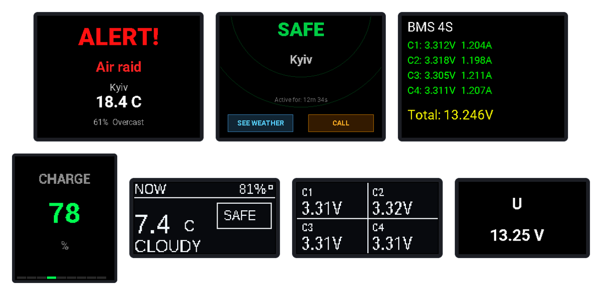

<div align="center">

# Hi, I am `ZeroDaylight0` 👋

### IoT • Smart Home • Automation • Infrastructure • Software

I build practical systems that connect hardware, networks and code into one
working environment.

```text
sensor / device → MQTT → automation → service → interface → result
```

<a href="https://github.com/ZeroDaylight0?tab=repositories"></a>
<a href="https://zerodaylight0.github.io/WEB_DisplayMaker_esp32/"></a>
<a href="https://zerodaylight0.github.io/PUBG-tracker/"></a>

</div>

---

## 🚀 Projects

### 🔌 Hardware and IoT

<table>
  <tr>
    <td width="50%" valign="top">
      <h3><a href="https://github.com/ZeroDaylight0/ESPHome-IoT">ESPHome IoT</a></h3>
      <p>ESP32 nodes running in my home: JK-BMS and 4S battery telemetry,
      INA219/ADS1115 energy monitoring, air-raid alert and weather displays,
      vibration sensors, an ESP32-CAM meter reader and Ethernet nodes, all
      over MQTT and Home Assistant.</p>
      <p>The screen images are rendered from the real display code, which is
      compiled on every push.</p>
      <p>
        
        
        
      </p>
    </td>
    <td width="50%" valign="top">
      <h3><a href="https://github.com/ZeroDaylight0/WEB_DisplayMaker_esp32">PixelForge</a> · <a href="https://zerodaylight0.github.io/WEB_DisplayMaker_esp32/">live demo</a></h3>
      <p>Browser-based visual editor for OLED, TFT and e-paper screens:
      drag-and-drop layouts for 28 displays and boards (CYD, T-Display,
      M5Stack), import of existing <code>.ino</code> and ESPHome YAML, and
      export to U8g2, Arduino_GFX, ESPHome, PNG and SVG. Self-hosted accounts
      and sync with Node.js, SQLite and Docker.</p>
      <p>
        
        
        
      </p>
    </td>
  </tr>
  <tr>
    <td><a href="https://github.com/ZeroDaylight0/ESPHome-IoT"></a></td>
    <td><a href="https://github.com/ZeroDaylight0/WEB_DisplayMaker_esp32"></a></td>
  </tr>
</table>

### 🧰 Tools and applications

<table>
  <tr>
    <td width="50%" valign="top">
      <h3><a href="https://github.com/ZeroDaylight0/PUBG-tracker">PUBG Tracker</a> · <a href="https://zerodaylight0.github.io/PUBG-tracker/">live demo</a></h3>
      <p>Local match analyzer with an interactive tactical map: routes,
      kills, knocks, zones and squad statistics from the official PUBG API.
      The API key stays on the local machine.</p>
      <p>
        
        
      </p>
    </td>
    <td width="50%" valign="top">
      <h3><a href="https://github.com/ZeroDaylight0/signal-log-analyzer">Signal/Log</a></h3>
      <p>Local-first log analyzer: drop in a log and get evidence-backed
      findings, a timeline and next steps from Gemini, OpenAI, Claude or
      Grok.</p>
      <p>
        
        
      </p>
    </td>
  </tr>
  <tr>
    <td><a href="https://github.com/ZeroDaylight0/PUBG-tracker"></a></td>
    <td><a href="https://github.com/ZeroDaylight0/signal-log-analyzer"></a></td>
  </tr>
  <tr>
    <td colspan="2" valign="top">
      <h3><a href="https://github.com/ZeroDaylight0/TGBOT_logger">TGbot_tracker</a></h3>
      <p>Local archive of messages, photos, videos and voice messages sent to
      your Telegram bots, with encrypted tokens and a Telegram-style web UI.
      
      </p>
    </td>
  </tr>
</table>

## 🛠️ What I work with

| Area | What I build |
|---|---|
| 🏠 Smart home | Home Assistant automations, openHAB rules, Node-RED flows, control panels |
| 🧩 ESPHome / ESP32 | Sensors, relays, displays, energy monitoring, BMS telemetry, custom hardware |
| 📡 MQTT | State exchange between devices, services and controllers |
| 🔐 Networking and VPN | Remote access, segmentation and secure service connections |
| 🤖 Automation | Python, PowerShell and small utilities for repetitive tasks |
| 💻 Applications | Local web apps and data analysis tools |

<p>
  
  
  
  
  
  
  
  
  
  
  
  
</p>

## 🔒 How I work

- **Working beats impressive.** A project should run and solve a real problem.
- **Security by default.** Secrets stay out of public code.
- **Documentation next to the code.** Pinouts, dependencies and limitations
  are written down.
- **Small iterations.** A working prototype first, then UX, reliability and
  maintainability.
- **AI as a tool, not a replacement for engineering.** I use it for research,
  drafts, debugging and documentation, then run the code, check it against
  real hardware and APIs and review security myself.

## 📌 Coming next

ESPHome configurations and wiring diagrams, Node-RED flows and MQTT patterns,
maintenance scripts, and notes about VPN, networking and local services.

<div align="center">

### Thanks for stopping by! ⭐

If a project is useful to you, leave a star or open an issue with an idea.

</div>
